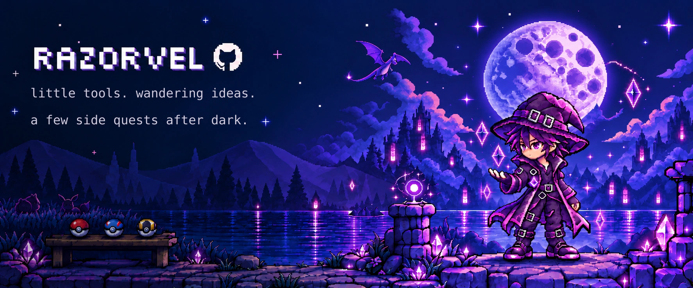
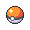
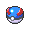
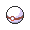

## Hey, welcome to my little corner of GitHub.

I like exploring software, making small tools, and finding ways to make everyday computing a little more comfortable.

##  Side quests

A few projects from the journey. Some practical, some experimental.

<table>
  <thead><tr><th>Project</th><th>What you’ll find</th></tr></thead>
  <tbody>
    <tr>
      <td><a href="https://github.com/RazorVel/vigilens">Vigilens</a> Logs &amp; dashboards</td>
      <td>Making Linux logs easier to explore, with configurable parsing rules, searchable events, and a customizable dashboard. From raw log entries to structured data and live visualizations. <strong>Stack</strong> · JavaScript, React, Node.js, Express, MongoDB, Bash, Docker</td>
    </tr>
    <tr>
      <td><a href="https://github.com/RazorVel/ChronoCue">ChronoCue</a> Time &amp; routines</td>
      <td>A small Linux desktop companion for reminders, Pomodoro sessions, countdowns, and a stopwatch. Schedule presets, selectable sounds, and desktop notifications. <strong>Stack</strong> · Python, Tk, systemd</td>
    </tr>
    <tr>
      <td><a href="https://github.com/RazorVel/auen">auen</a> Music &amp; terminals</td>
      <td>A keyboard-first audio player that keeps music in the terminal, with search, streaming, queues, and playlists. Playback history and a local cache for keeping tracks close. <strong>Stack</strong> · Python, Textual, mpv, yt-dlp</td>
    </tr>
    <tr>
      <td><a href="https://github.com/RazorVel/MatteCast">MatteCast</a> Cameras &amp; media</td>
      <td>A Linux virtual camera with real-time background blur, removal, and replacement. GPU-accelerated video matting with a desktop control panel. <strong>Stack</strong> · C++, Python, OpenCV, ONNX Runtime, CUDA, PySide6, Podman / Docker</td>
    </tr>
  </tbody>
</table>

[Wander through the other repositories →](https://github.com/RazorVel?tab=repositories)

##  Tool bag

Some of the tools used across these repositories.

**Languages** · `Python` `JavaScript` `C++` `Bash` 
**Interfaces** · `React` `Textual` `Tk` `PySide6` 
**Data & services** · `Node.js` `Express` `MongoDB` `Docker / Podman` 
**Media & models** · `OpenCV` `ONNX Runtime` `mpv` `yt-dlp`

##  What keeps me curious

- Small tools that earn a place in everyday routines.
- Interfaces that feel clear and comfortable.
- Linux, terminals, and the occasional rabbit hole.

##  Elsewhere

For a little more background, or just to say hello: 
[Feliks Hartanto on LinkedIn ↗](https://www.linkedin.com/in/feliks-hartanto/)

**Save point** 
Still exploring. Still learning. One small improvement at a time.

 

Sprites: <a href="https://github.com/PokeAPI/sprites">PokéAPI</a> · <a href="docs/ASSETS.md">Art credits</a> · <a href="LICENSE">MIT</a>
